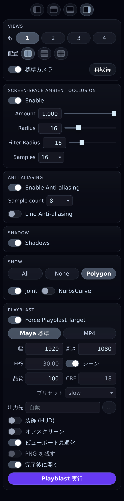
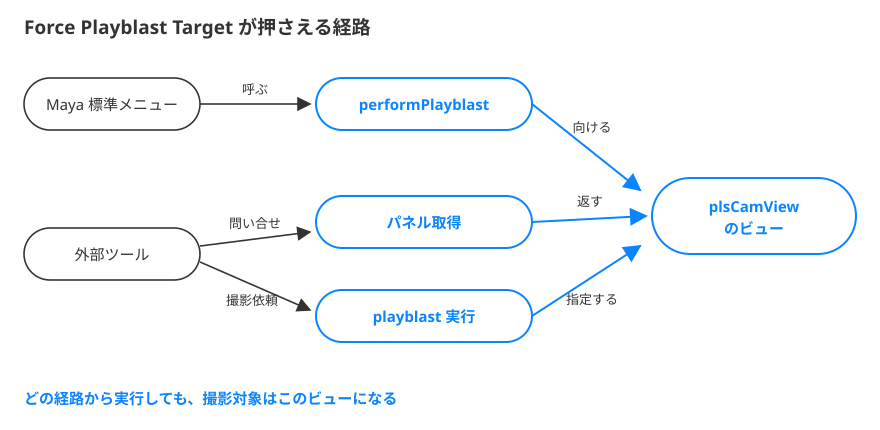

# plsCamView

Maya のメインウィンドウから分離した、ツールボックス付きのカメラビュー。

Maya 標準の **Tear Off Copy** と同じメニュー（View / Shading / Lighting / Show /
Renderer / Help）とアイコンバー（ツールセット）をそのまま備えたビューポートに、
制作でよく触る設定をまとめたツールボックスを付けたものです。
最大 4 ビュー、レゾリューションゲートと構図ガイドのオーバーレイ、
Playblast 対象の固定、MP4 書き出しまでを 1 つのウィンドウで行えます。

> A detached camera viewport for Maya, with a docked toolbox for the settings you
> touch most: camera switching, multi-view layouts, resolution-gate / composition-guide
> overlays, SSAO, anti-aliasing, shadows, show presets, and a "Force Playblast Target"
> switch that pins every playblast — from Maya's own menu or from your own Python
> tools — to this view. MP4 export via ffmpeg. All state is persisted.

**バージョン 0.9.0（初回公開版）／ MIT License**

📖 **全機能ガイド**: [日本語](docs/USER_GUIDE_ja.md) ／ **Full user guide**: [English](docs/USER_GUIDE_en.md)
（2026-10-24: ガイド各節に UI 画像を追加。画像は公開版 v0.9.0 ソースの offscreen Qt 描画です）

<p align="center">
  
  <br><sub>※参考画像（開発中の画面）。Gate / Guides / Language など現行 0.9.0 の全機能と配置は
  <a href="docs/USER_GUIDE_ja.md">ガイド</a>を参照してください。</sub>
</p>

---

## 特徴

- **Tear Off Copy と同じ操作感** — メニュー・アイコンバーはすべて Maya 標準のまま
- **ツールボックスを上下左右に配置** — 境界ドラッグで幅も調整、比率まで記憶
- **最大 4 ビュー** — 横並び / 縦並び / グリッドで配置。各ビューは別ウィンドウへポップアウトでき、
  戻すのもワンクリック。設定パネルは 1 つのまま、カメラだけ各ビューで選べる
- **カメラ切り替え** — 各ビュー上部のバーでシーン内のカメラを選ぶだけ
- **Gate / Guides オーバーレイ** — レゾリューションゲート（マスク・枠・内側ゲート×3）と
  構図ガイド（三分割 / 黄金・白銀の比率グリッド / アーマチュア / 中心）。
  画面確認専用のオーバーレイで、**Playblast には写りません**
- **SSAO / Anti-aliasing / Shadow / Show** をひとまとめに
- **Force Playblast Target** — どこから Playblast を実行してもこのビューが対象になる
- **MP4 書き出し** — ツール内の Playblast を ffmpeg で直接 MP4(H.264) に。
  解像度 / FPS / CRF / プリセット / 品質 / ビューポート最適化などを指定可能
- **複数カメラ出力（Multi）** — 複数ビューを選んで順次撮影、位置・比率を保った 1 本への合成も可能
- **UI 言語** — 日本語 / English / システム追従
- **状態を完全復元** — 次に開いたときは前回と同じ状態

---

## 動作環境

- Maya 2022 以降（PySide2 / PySide6 の両方に対応）
- Windows / macOS / Linux（パスの扱いは OS 非依存。MP4 出力は Windows で検証済み）

---

## インストール

### plsCamView_install.py をドラッグ & ドロップ（推奨）

1. リリースの zip をダウンロードして展開します。
2. `plsCamView_install.py` を **Maya のビューポートへドラッグ & ドロップ**します。
3. 開いたウィンドウで **［Install］** を押します。

`<Maya userAppDir>/modules/plsCamView/` に本体が、`plsCamView.mod` にモジュール定義が
作成され、その場で使えるようになります（Maya の再起動は不要）。
「現在のシェルフに起動ボタンを追加する」にチェックを入れておくと、
シェルフボタンも同時に作られます。同じシェルフに、このパッケージの同じ起動コマンドのボタンがあれば更新します。

更新（上書きインストール）のときは、新版のコピーが完了してから旧版を退避し、
公開に失敗した場合は旧版へ自動で戻します。

アンインストールは上記 2 つを削除するだけです。

### 手動で入れる場合

`scripts/plsCamView` フォルダを Maya の scripts パス上に置くだけでも動きます。

```
<Maya userAppDir>/scripts/plsCamView/
```

---

## 使い方

```python
import plsCamView
plsCamView.show()
```

その他のコマンド：

```python
plsCamView.close()            # 閉じる
plsCamView.restart()          # 最新コードで開き直す（Maya 再起動は不要）
plsCamView.reset_settings()   # 保存済み設定を初期化して開き直す
plsCamView.playblast_mp4()    # ツールボックスの設定で MP4 書き出し
```

パッケージを別パッケージの配下に置いた場合は、その位置に合わせて import してください
（例: `from mytools.anim import plsCamView`）。モジュール名は実行時に動的解決しているので、
どこに置いても動きます。

---

## 機能の概要

詳しい操作はガイド（[日本語](docs/USER_GUIDE_ja.md) / [English](docs/USER_GUIDE_en.md)）へ。

| カード | 内容 |
|---|---|
| **Views** | ビュー数（1〜4）と配置（横並び / 縦並び / グリッド）、標準カメラの表示、カメラ一覧の再取得 |
| **Show** | All / None / Polygon のプリセット ＋ Joint / NurbsCurve スイッチ（全ビュー共通） |
| **Shadow** | `Lighting > Shadows` の ON/OFF（このツールのビューだけ） |
| **Effects** | SSAO / Anti-aliasing / Line AA（Viewport 2.0 の共通設定。一括 ON/OFF つき） |
| **Gate** | レゾリューションゲート: ゲート外マスク（色・不透明度）、枠線、内側ゲート×3（%・色・線/塗り・破線） |
| **Guides** | 構図ガイド: 三分割 / 比率グリッド（黄金比 φ・白銀比 √2） / アーマチュア / 中心。合わせ先（ゲート / 内側ゲート / ビュー全体）と色・太さ・不透明度 |
| **Playblast** | Force Playblast Target、Multi（複数カメラ出力・合成）、出力形式（Maya 標準 / MP4）と書き出し設定 |

### Gate / Guides について

- **ゲート矩形**はカメラの viewing frustum（ビューの縦横比・オーバースキャン・パン/ズーム込み）と
  rendering frustum（レンダー解像度の縦横比）の比から求めます。カメラ操作に追従します。
- **三分割（Thirds）** — 1/3・2/3 の縦横線。
- **比率グリッド（Ratio Grid）** — 黄金比 φ では 0.382 / 0.618、白銀比 √2 では 0.414 / 0.586 の縦横線。
- **アーマチュア（Armature）** — 対角線 2 本 ＋ 各隅から対角線への垂線（reciprocal）4 本 ＋
  交点（目）を通る縦横 4 本。黄金比（または白銀比）の矩形で計算して枠に引き伸ばします。
- いずれも**画面上のオーバーレイ**で、VP2 のレンダラ設定には触れず、**Playblast には写りません**。

### Force Playblast Target

Maya の Playblast は本来「フォーカスのあるパネル」を対象にするため、
別ウィンドウのビューはクリックしていないと対象になりません。
このスイッチを ON にすると、**Maya 標準・外部ツールのどちらから実行しても**
対象がこのビューになるよう、パネル取得（`cmds.playblast(activeEditor=True)` /
`cmds.getPanel(withFocus=True)`）と実行の両方を押さえます。

<p align="center">
  
</p>

対象外・例外（MEL 直呼びは捕まえられない、明示指定の尊重、OFF で完全復元など）は
[ガイド](docs/USER_GUIDE_ja.md#8-playblast) を参照してください。

### MP4 出力と ffmpeg

MP4 出力は **パッケージ内の `bin/ffmpeg.exe` だけ**を使います（PATH 上の ffmpeg は見ません。
環境ごとの版の違いを避けるためです）。

```
<Maya の userAppDir>/modules/plsCamView/scripts/plsCamView/bin/ffmpeg.exe
```

（https://www.gyan.dev/ffmpeg/builds/ などの静的ビルド。手動導入なら置いた先の
`plsCamView/bin/ffmpeg.exe`。）上書きインストールのとき、配布物に ffmpeg が無ければ
既に置いてある `bin/ffmpeg.exe` は自動で引き継がれます。

**リリース zip には ffmpeg.exe を同梱していません**（サイズとライセンスの都合）。
ffmpeg は LGPL/GPL のソフトウェアで、本ツールは外部プロセスとして呼び出すだけです。

### 複数カメラ出力（Multi）

Playblast カードの **Multi** を ON にすると複数ビューを対象に選べ、順次撮影します。
**合成**を ON にすると、表示中の位置・比率を保って 1 本の `_Multi.mp4` に合成できます
（**個別保持** ON で各カメラの出力も残す）。操作と制限は
[docs/MULTI_PLAYBLAST.md](docs/MULTI_PLAYBLAST.md) を参照してください。

---

## 設定の保存

すべての状態（カメラ／SSAO／AA／Shadow／Show／Gate・Guides／ツールボックスの位置と比率／
ウィンドウ位置・サイズ／Force Playblast Target／Playblast 出力設定／ビューの数・配置・
各ビューのカメラとポップアウト状態／UI 言語）は自動保存され、次回起動時に復元されます。

```
<Maya userPrefDir>/plsCamView/settings.json
```

JSON を直接編集して調整できる項目：

| キー | 既定 | 内容 |
|---|---|---|
| `applyVp2OnStartup` | `true` | 起動時に SSAO / AA を復元適用する。`false` なら Maya の現在値を読むだけ |
| `playblastMode` | `"direct"` | `"direct"` は常に `editorPanelName` 指定でツール側実行。`"auto"` はフォーカスが効いていれば Maya 標準へ |
| `forceActivePanel` | `true` | `getPanel(withFocus=True)` などがこのビューを返すようにする |
| `playblastVerbose` | `false` | Playblast 周りの詳細ログを Script Editor に出す |
| `useCopyPanel` | `true` | ビューを既存パネルの複製として作る。`false` で新規パネル作成 |
| `toolboxPercent` | `26` | ツールボックス側のペイン比率（%） |
| `language` | `"system"` | UI 言語（`"system"` / `"ja"` / `"en"`） |

---

## 実装メモ

Maya で同種のツールを作る人向けの、つまずきどころの記録です。

**modelPanel を Qt のウィンドウへ付け替えてはいけない**
Maya は UI のフルパスを Qt の親をたどって組み立てるため、`QMainWindow` などに
移すと `myWindow||paneLayout10|modelPanel10` のように空セグメントが混ざり、
`updateModelPanelBar` が MEL の構文エラーになってアイコンバーとメニューが
機能しなくなります。本ツールはウィンドウ自体を `cmds.window` で作り、
modelPanel は Maya レイアウトの子のままにしています。

**Maya のレイアウトは内部に独自の QLayout を持つ**
`formLayout` などの QWidget に新しく `QVBoxLayout` を `setLayout` しても Qt に
無視され、子ウィジェットがサイズ 0 のまま見えなくなります。既存の layout があれば
それを使い、無ければ作る、という手順が必要です。

**`performPlayblast` をラップするときはシグネチャを合わせる**
戻り値型や引数が違うと
`New procedure definition ... has a different argument list and/or return type.`
の警告が出て、ラッパーが呼ばれません。オリジナルの .mel を読んで
戻り値型・引数リストを解析し、同じ形で再定義しています。

**パッケージのリロードは親パッケージの属性まで消す**
`sys.modules` から消しても、親パッケージが属性として古いモジュールを保持しているため、
`from parent import pkg` が古い方を返します。`restart()` は親側の属性も削除してから
`importlib.import_module` で読み直します。

**ゲートのオーバーレイは入力を素通しする透明ウィンドウ**
VP2 のレンダラ設定には触れず、ビューポートの Qt ウィジェットに重ねて追従させます。
ゲート矩形の計算は `MFnCamera` の viewing frustum と rendering frustum の比です。

---

## ドキュメント

- [使い方ガイド（日本語）](docs/USER_GUIDE_ja.md)
- [User Guide (English)](docs/USER_GUIDE_en.md)
- [複数カメラ出力（Multi）](docs/MULTI_PLAYBLAST.md)
- [変更履歴](CHANGELOG.md)
- 構造図: [アーキテクチャ](docs/architecture.html) / [処理の流れ](docs/workflow.html)（ブラウザで開く）

## ライセンス

MIT License. 詳細は [LICENSE](LICENSE) を参照してください。
ffmpeg は同梱していません。別途配置する場合、ffmpeg は LGPL/GPL のソフトウェアで、
本ツールは外部プロセスとして起動するだけです（リンク・改変はしません）。
