# plsCamView – User Guide (v0.9.0, images added 2026-10-24)

> UI images in this guide are rendered offscreen with Qt from the published v0.9.0 source
> (they are not screenshots of a running Maya session; the UI code is identical).

A detached camera viewport for Maya with a docked toolbox. It makes the everyday flow of
"keep a camera-locked view in its own window and playblast from that view" a one-click,
reliable operation.

日本語ガイド: [USER_GUIDE_ja.md](USER_GUIDE_ja.md)

---

## 1. What it does

- Up to **four camera views** detached from the main window (row / column / grid layouts;
  each view can pop out into its own window)
- **Per-view camera switching** from the scene's camera list
- **Gate** — resolution-gate overlay (mask, frame, and up to three inner gates)
- **Guides** — composition-guide overlay (thirds / golden- or silver-ratio grid / armature / center)
- **Effects** — SSAO and anti-aliasing with a master on/off and individual controls
- **Shadow** — `Lighting > Shadows` for this tool's views only
- **Show** — All / None / Polygon presets plus Joint / NurbsCurve switches
- **Force Playblast Target** — pins every playblast, whether run from Maya's own menu or
  from your Python tools, to this view
- **Playblast output** — Maya's native format, or **MP4 (H.264)** via ffmpeg (placed in `bin/`)
- **Multi-camera output (Multi)** — capture several views in sequence, optionally composited
  into one movie that keeps each view's position and proportions
- **UI language** — Japanese / English / follow the system
- Everything (cameras, settings, layout, window positions) is saved and restored automatically

---

## 2. Requirements

- Autodesk Maya **2022 or later** (PySide2 or PySide6)
- Windows / macOS / Linux (MP4 export is tested on Windows; on other platforms put an
  `ffmpeg` binary in `bin/`)

---

## 3. Install (3 steps)

1. Unzip the downloaded zip anywhere.
2. Drag & drop **`plsCamView_install.py`** onto the Maya viewport.
3. Press **[Install]** in the window that opens.

Done — no Maya restart required. Tick "add a launch button to the current shelf" if you
want a shelf button.

Installed to:
```
<Maya userAppDir>/modules/plsCamView/     … the tool
<Maya userAppDir>/modules/plsCamView.mod  … module definition
```
(`userAppDir` is usually `C:/Users/<you>/Documents/maya/`.)

### Updating

Repeat the same steps with a newer zip. The installer copies the new version first, then
sets the old one aside, and automatically rolls back to the old version if publishing
fails. An already-open window picks up the new version the next time you call
`plsCamView.show()`.

### Uninstall

Delete the folder and the `.mod` file above. Also delete the settings file (chapter 9)
if you no longer need it.

---

## 4. Launch

From a shelf button, or in the Script Editor (Python):

```python
import plsCamView
plsCamView.show()
```

Closing the window with × is fine; the current state is saved at that moment.

---

## 5. The window

```
┌──────────────────────────────────────┬──────────────┐
│ [● PLAYBLAST]  < 📷 camera ▾ >  VIEW 1 ↗ │  Toolbox      │
│  ┌────────────────────────────────┐  │  Dock pos.    │
│  │  Maya viewport                 │  │  Language     │
│  │  (menus + icon bar)            │  │  Views        │
│  │                                │  │  Show         │
│  └────────────────────────────────┘  │  Shadow       │
│                                      │  Effects      │
│                                      │  Gate         │
│                                      │  Guides       │
│                                      │  Playblast    │
└──────────────────────────────────────┴──────────────┘
```

- The viewport is a full Maya viewport with the same menus (View / Shading / Lighting /
  Show / Renderer) and icon bar as *Tear Off Copy*. All Maya operations work as usual.
- The bar above each view is the **camera bar**:
  - **● PLAYBLAST** (left) … this view is the playblast target (exactly one with Multi off;
    the target is lit **purple**; click to move it)
  - **📷 camera name ▾** (center) … switch the displayed camera; **<** / **>** step through cameras
  - **↗** (right) … pop the view out into its own window (**⭲**, or closing the window,
    brings it back)
- Drag the splitter to resize the toolbox; it can be docked left / right / top / bottom.
  Docked top or bottom, the cards flow horizontally and the height shrinks to fit
  (the Playblast card is pinned at the right so the run button is always reachable).

<p align="center">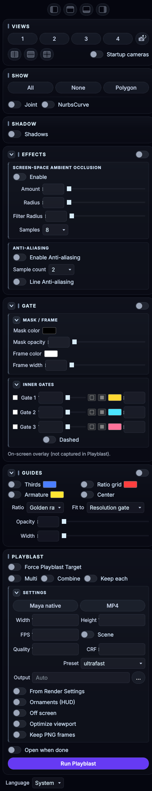</p>

---

## 6. Basics

### Switching cameras
Click the camera name in the middle of the camera bar and pick from the list, or step
with **<** / **>**. The list refreshes automatically when a scene is opened; refresh it
manually with the **camera-refresh icon** in the Views card (📷 with ↻).
Turn the **standard cameras** switch off to hide persp / top / front / side from the list.

### Adding and arranging views

<p align="center">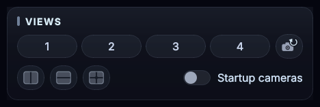</p>

Use the **1–4** buttons in the Views card for the view count and the icons below for the
**layout** (row / column / grid). Grid: 2 = side by side, 3 = one on top + two below,
4 = 2×2. There is only one settings panel; Show and Shadow apply to all views. Only the
camera is per view.

### Popping a view out
**↗** on the camera bar moves the view into its own window — handy on a second monitor.
Closing the popped-out window returns the view to the main window. Window positions are
remembered.

### Switching the UI language

<p align="center">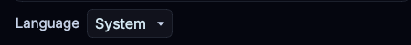</p>

In v0.9.0 the **Language row sits at the bottom of the toolbox**: **System / 日本語 / English**
(the first edition of this guide said "top" by mistake; from v0.9.1 it moves to the top row
next to the layout icons). System follows
Maya / OS language. The choice is saved; **labels are applied the next time the window is
opened** (dialogs and warnings switch immediately). Identifiers, node names and paths are
never translated.

---

## 7. Toolbox

### Effects

<p align="center">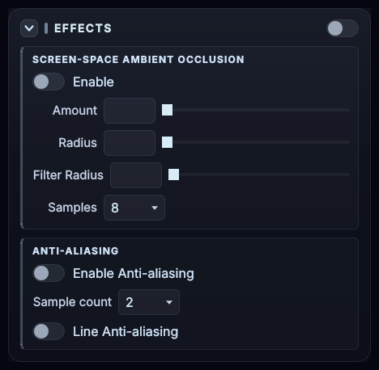</p>
The switch on the card header toggles **SSAO + anti-aliasing + line AA together** while
keeping each individual setting (restored when switched back on). The button on the left
of the header collapses the card.

- **Screen-space Ambient Occlusion** … Enable / Amount / Radius / Filter Radius / Samples
- **Anti-aliasing** … Enable / Sample count / Line Anti-aliasing

> Note: SSAO and AA are Viewport 2.0 **global** settings. Changing them here affects every
> viewport in Maya (the same options as Renderer > Viewport 2.0 settings).

### Shadow

<p align="center">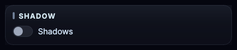</p>

`Lighting > Shadows` on/off — **for this tool's views only**.

### Show

<p align="center">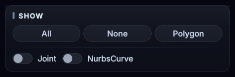</p>

**All / None / Polygon** presets plus **Joint / NurbsCurve** switches. Pressing a preset
also sets Joint / NurbsCurve to that preset's state (All = both on, None / Polygon = both
off); switch individual items back on from there.

### Gate (resolution gate)

<p align="center">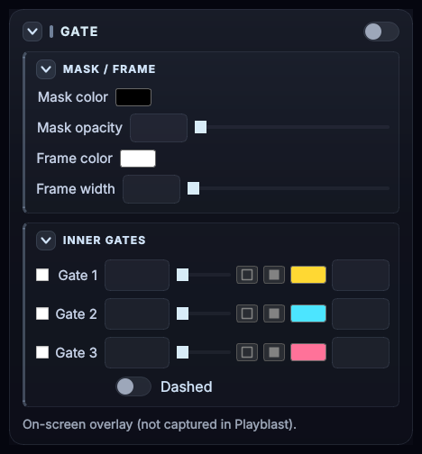
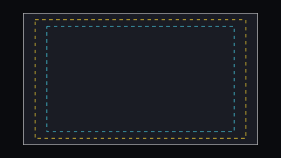</p>

Turn the switch on the card header on to overlay the **resolution gate** (the render-
resolution region) on every view. The gate rectangle is computed from the ratio of the
camera's viewing frustum (view aspect, overscan, pan/zoom included) to its rendering
frustum (render-resolution aspect), and follows camera operations.

- **Mask / Frame** … color and opacity of the mask outside the gate; color and width of
  the gate frame line
- **Inner gates** … up to **three inner gates as a percentage of the gate**. Each has
  on/off, percent, color, **stroke** (1 px; Dashed for a dashed line) and **fill**
  (covers the area outside that inner gate, inside the resolution gate) with its own fill
  opacity. Useful for safe frames and caption-safe areas.

> The gate and the guides below are **on-screen overlays**. They never touch VP2 renderer
> settings and **do not appear in playblasts** (screen check only).

### Guides (composition guides)

<p align="center">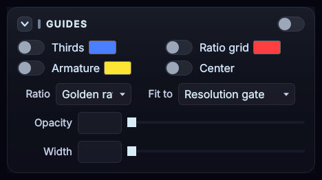</p>

The switch on the card header toggles all guides at once (each family's own switch is
preserved). The comparison figures below are rendered by the actual drawing code in
gate_overlay.py.

| Thirds | Ratio Grid (golden φ) |
|---|---|
| 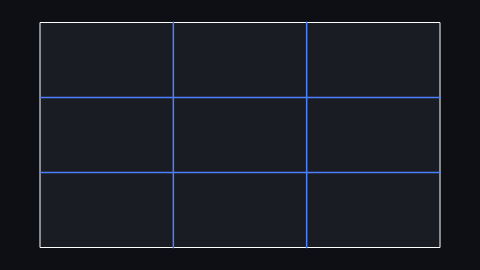 | 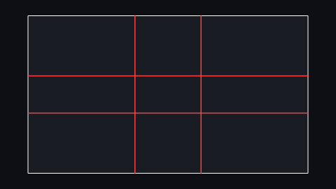 |

| Ratio Grid (silver √2) | Armature (golden φ) |
|---|---|
| 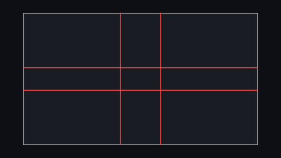 | 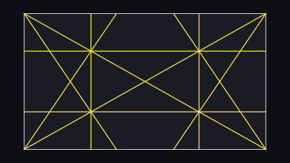 |

| Armature (silver √2) | |
|---|---|
| 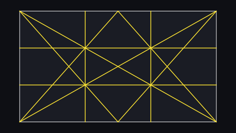 | |

| Guide | Meaning of the lines |
|---|---|
| **Thirds** | vertical and horizontal lines at 1/3 and 2/3 (2 + 2 lines) |
| **Ratio Grid** | lines at the division points of the chosen ratio: **0.382 / 0.618 for the golden ratio φ**, **0.414 / 0.586 for the silver ratio √2** |
| **Armature** | **2 diagonals** + **4 reciprocals (perpendiculars from each corner onto a diagonal)** + **4 vertical/horizontal lines through the intersections (the "eyes")**. Computed on a golden- (or silver-) ratio rectangle and stretched to the target frame |
| **Center** | a cross mark at the center |

- **Ratio** … golden ratio φ (≈1.618) / silver ratio √2 (≈1.414); used by the Ratio Grid
  and the Armature.
- **Fit to** … the rectangle the guides are fitted to: **resolution gate** (default) /
  **inner gate 1–3** (uses the Inner gates percentages; they can be used for the math even
  when not displayed) / **whole view**.
- Per-family **colors** (Thirds / Grid / Armature), **Opacity** and **Width**.

### Playblast

<p align="center">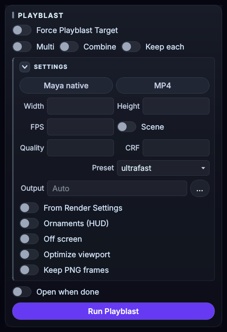</p>

Only **Force Playblast Target / Multi / open when done / [Run Playblast]** are always
visible; everything else lives in the collapsible **SETTINGS** section (while collapsed,
its header shows the current values, e.g. "Maya 1920×1080 scene fps"). See the next
chapter.

---

## 8. Playblast

### Force Playblast Target
Maya's playblast normally targets "the panel with focus", so a view in another window is
captured only while you keep it clicked. With this switch on, the target is pinned to
this tool's view **whether the playblast is run from Maya's own menu (Windows >
Playblast) or from a Python tool** — including the display changes tools make before
capturing (e.g. polygons-only), so automation behaves as intended.

Not covered / exceptions:

- Tools that run playblast **directly from MEL** are not covered
- When a tool **explicitly names its target panel, that choice is respected**
- **Read-only (query) calls are left untouched**
- The playblast **option box (□) opens Maya's standard dialog**
- Switching off (or closing the window) **restores Maya completely**

### Output (Maya native / MP4)
Capture with **[Run Playblast]** in the toolbox. Open **SETTINGS** and choose the output
format, **Maya native / MP4**; the export settings are shared by both formats.

| Item | Meaning |
|---|---|
| Width / Height | output resolution (default 1920×1080) |
| FPS / scene | movie frame rate; "scene" derives it from the scene time unit |
| Quality | playblast quality (1–100) |
| CRF | H.264 quality; lower = better/larger (18–23 recommended) — MP4 only |
| Preset | x264 encoding speed (slower = smaller at the same CRF) — MP4 only |
| Output path | empty = `<project>/movies/<scene>_<camera>` |
| Ornaments (HUD) | `showOrnaments` (HUD, camera name, …) |
| Off-screen | `offScreen` (unaffected by overlapping windows) |
| Viewport optimization | during export only: lock the view to the render frame (resolution gate) / polygons only / Use All Lights / SSAO + line AA + MSAA on — restored afterwards |
| Keep PNGs | keep the intermediate PNG sequence — MP4 only |
| Open when done | open the exported movie (Maya's viewer for the native format) |

The frame range is the time slider's Start / End. All values are saved automatically.

> The Gate / Guides overlays never appear in playblasts.

### Multi-camera output (Multi)

Turn **Multi** on to select several targets with **● PLAYBLAST** on each view's camera
bar (up to 4); they are captured in sequence. With **Composite** on, the outputs are
combined into a single `_Multi.mp4` that keeps each view's on-screen position and
proportions; **Keep individual** also saves each camera's own movie. Existing outputs are
never overwritten. For the full rules (naming, duplicate camera names, what is preserved
on cancel/failure) see [MULTI_PLAYBLAST.md](MULTI_PLAYBLAST.md).

### What MP4 export needs (ffmpeg)
MP4 export uses only the `ffmpeg.exe` placed in the package's `bin/` folder (ffmpeg on
PATH is not used). When installed with the installer, the actual location is:

```
<Maya userAppDir>/modules/plsCamView/scripts/plsCamView/bin/ffmpeg.exe
e.g. C:/Users/<you>/Documents/maya/modules/plsCamView/scripts/plsCamView/bin/ffmpeg.exe
```

(If you placed the package on a scripts path manually, it is that `plsCamView/bin/ffmpeg.exe`.
The MP4 error message also prints the exact path to use.)

**Updates never remove it** — when you install a newer zip over an existing install and the
distribution does not bundle ffmpeg, your existing `bin/ffmpeg.exe` is carried over
automatically.

On Windows the "essentials" build from https://www.gyan.dev/ffmpeg/builds/ works (take
`bin/ffmpeg.exe` out of the zip and drop it in). ffmpeg is separate software (LGPL/GPL);
this tool only launches it as an external process.

### From Python
```python
import plsCamView
plsCamView.playblast_mp4()                                       # export with the toolbox settings
plsCamView.playblast_mp4(output_path="D:/out/s01.mp4", crf=20)   # override some of them
```
Returns `(ok, message, output_path)`.

---

## 9. Saving and resetting settings

Everything is saved automatically to:

```
<Maya userPrefDir>/plsCamView/settings.json
e.g. C:/Users/<you>/Documents/maya/2026/prefs/plsCamView/settings.json
```

To reset to defaults, run in the Script Editor:
```python
import plsCamView
plsCamView.reset_settings()
```

---

## 10. Troubleshooting

| Symptom | Fix |
|---|---|
| The window does not appear / nothing happens | Check the Script Editor for errors; reopen with `plsCamView.restart()` |
| Viewport menus / icon bar do not respond | Set `useCopyPanel` to `false` in settings.json and reopen |
| Playblast captures another view | Turn **Force Playblast Target** on; check **● PLAYBLAST** is lit purple on the intended view |
| "ffmpeg not found" for MP4 | Place `bin/ffmpeg.exe` (chapter 8) |
| Changing SSAO / AA changed all of Maya | By design (Viewport 2.0 global settings); the Effects master switch restores them |
| Gate or guides are not visible | Check the switch on the Gate / Guides card header, and (for guides) the per-family switches such as Thirds |
| I want the gate in the playblast | It never appears (screen-check overlay). To export at the render frame, use the "viewport optimization" option that locks the view to the resolution gate |
| The UI language did not change | Labels apply the next time the window is opened; `plsCamView.restart()` also applies them |
| Code updates do not show up | `plsCamView.restart()` (no Maya restart needed) |

---

## 11. License

MIT License. ffmpeg is separate software under its own license (LGPL/GPL); this tool only
invokes it as an external process.
