# plsCamView 使い方ガイド（v0.9.1）

> 本ガイドの UI 画像は実装そのままを offscreen Qt で描画したものです（実際の Maya 画面の
> スクリーンショットではありません。見た目は同じ UI コードです）。

Maya のメインウィンドウから切り離した、ツールボックス付きのカメラビューです。
アニメーション作業中に「カメラを固定したビューを別ウィンドウに出し、そのビューで Playblast を撮る」
という流れを、ワンクリックで安定して行うためのツールです。

English guide: [USER_GUIDE_en.md](USER_GUIDE_en.md)

---

## 1. できること

- メインウィンドウから独立した **カメラビューを最大 4 つ**（横並び / 縦並び / グリッド、各ビューは別ウィンドウへポップアウト可）
- ビューごとの **カメラ切り替え**（シーン内のカメラ一覧から選択）
- **Gate** — レゾリューションゲート（レンダー解像度の範囲）のマスク・枠・内側ゲート×3 をオーバーレイ表示
- **Guides** — 構図ガイド（三分割 / 黄金・白銀の比率グリッド / アーマチュア / 中心）をオーバーレイ表示
- **Effects** — SSAO / アンチエイリアスを一括 ON/OFF、個別調整
- **Shadow** — このビューだけ影 ON/OFF
- **Show** — All / None / Polygon のプリセット ＋ Joint / NurbsCurve の追加スイッチ
- **Force Playblast Target** — Maya 標準メニューからでも外部ツールからでも、Playblast の対象をこのビューに固定
- **Playblast 出力** — Maya 標準形式、または ffmpeg（別途 `bin/` に配置）による **MP4（H.264）** 書き出し
- **複数カメラ出力（Multi）** — 複数ビューを順次撮影し、位置・比率を保った 1 本に合成も可能
- **UI 言語** — 日本語 / English / システム追従
- すべての状態（カメラ / 設定 / 配置 / ウィンドウ位置）を自動保存し、次回起動時に復元

---

## 2. 動作環境

- Autodesk Maya **2022 以降**（PySide2 / PySide6 どちらでも可）
- Windows / macOS / Linux（MP4 出力は Windows で検証済み。他 OS では `bin/ffmpeg` を置いてください）

---

## 3. インストール（3 ステップ）

1. ダウンロードした zip を任意の場所に展開します。
2. 展開したフォルダにある **`plsCamView_install.py` を Maya のビューポートへドラッグ & ドロップ**します。
3. 表示されるウィンドウで **［インストール］** を押します。

<p align="center">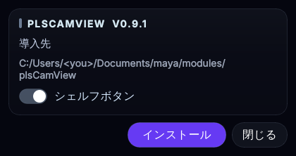</p>

インストーラは CamView 本体と同じ見た目の小さなダイアログです（0.9.1）。導入先の確認、
シェルフボタンの有無を選んで［インストール］を押すだけです。説明の詳細は各項目の
ツールチップに出ます。

これで完了です。Maya の再起動は不要です。
「現在のシェルフに起動ボタンを追加する」にチェックを入れておくと、シェルフに起動ボタンが作られます。

インストール先:
```
<Maya の userAppDir>/modules/plsCamView/     … 本体
<Maya の userAppDir>/modules/plsCamView.mod  … モジュール定義
```
（`userAppDir` は通常 `C:/Users/<ユーザー名>/Documents/maya/`）

### 更新（上書きインストール）

新しい zip で同じ手順を繰り返すだけです。新版のコピーが完了してから旧版を退避し、
公開に失敗した場合は旧版へ自動で戻します。更新後に開いているウィンドウは、
次に `plsCamView.show()` したときに新しい版を読み直します。

### アンインストール

上記のフォルダとファイルを削除するだけです。設定ファイル（9 章）も不要なら削除してください。

---

## 4. 起動

シェルフボタン、または Script Editor（Python）で:

```python
import plsCamView
plsCamView.show()
```

閉じるときはウィンドウの × で構いません。その時点の状態が保存されます。

---

## 5. 画面の見方

```
┌──────────────────────────────────────┬──────────────┐
│ [● PLAYBLAST]  < 📷 カメラ名 ▾ >  VIEW 1 ↗ │ ツールボックス │
│  ┌────────────────────────────────┐  │  Dock 位置     │
│  │  Maya のビューポート            │  │  Language     │
│  │  (メニュー・アイコンバー付)       │  │  Views        │
│  │                                │  │  Show         │
│  └────────────────────────────────┘  │  Shadow       │
│                                      │  Effects      │
│                                      │  Gate         │
│                                      │  Guides       │
│                                      │  Playblast    │
└──────────────────────────────────────┴──────────────┘
```

- ビューポートは Maya 標準の「Tear Off Copy」と同じメニュー（View / Shading / Lighting / Show / Renderer）と
  アイコンバーを持っています。Maya の操作はすべてそのまま使えます。
- ビューの上のバーが **カメラバー** です。
  - 左の **● PLAYBLAST** … このビューが Playblast の対象（Multi OFF では常に 1 つ。**紫** に点灯しているビューが対象。クリックで切り替え）
  - 中央の **📷 カメラ名 ▾** … 表示カメラの切り替え。両脇の **<** **>** で前後のカメラへ順送り
  - 右の **↗** … このビューを別ウィンドウにポップアウト（ポップアウト中は **⭲** で戻す）
- ツールボックスは境界をドラッグして幅を変えられます。上下左右のどこにでも置けます。
  上下に置くとカードは横に並び、高さは中身に合わせて自動で最小になります（Playblast カードは右端に固定され、常に押せます）。

<p align="center">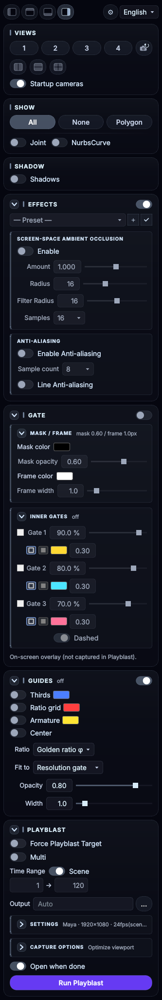</p>

---

## 6. 基本操作

### カメラを切り替える
カメラバー中央のカメラ名をクリックして一覧から選ぶか、両脇の **<** **>** で順送りします。
シーンを開き直すと一覧は自動更新されます。手動で取り直したいときは Views カードの **カメラ再取得アイコン**（📷 に ↻）。
**標準カメラ** スイッチを OFF にすると persp / top / front / side が一覧から消えます。
一覧の末尾の **＋ New** を選ぶと Maya 標準の新しいカメラを 1 台作り、そのビューだけを新しいカメラに切り替えます。

### ビューを増やす・並べ替える

<p align="center">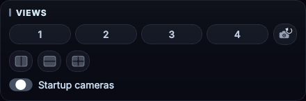</p>

Views カードの **1〜4** ボタンでビュー数、その下のアイコンで **配置**（横並び / 縦並び / グリッド）を切り替えます。
グリッドは 2 = 横並び、3 = 上 1 ＋ 下 2、4 = 田の字です。
設定パネルは 1 つだけで、Show と Shadow は全ビューに適用されます。カメラだけ各ビューで選べます。

### ビューをポップアウトする
カメラバーの **↗** で別ウィンドウになります。デュアルモニタで片方に出しておく使い方に向いています。
ポップアウトしたウィンドウを閉じると、自動でメインに戻ります。ウィンドウ位置も記憶されます。

### UI の大きさ（倍率）を変える

<p align="center">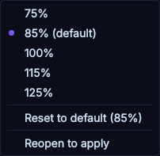</p>

最上部の **⚙（歯車）** から UI 倍率を **75 / 85 / 100 / 115 / 125%** で選べます
（既定は 85%。「標準へ戻す」で既定に戻ります）。文字だけでなく、ボタン・入力欄・
アイコン・余白・クリック範囲・メニューが同じ割合で変わります。OS の表示スケールには手を加えません。
ビューの描画、ゲート、Playblast の出力サイズは倍率の影響を受けません。
標準的な右ドック幅（ウィンドウ幅の約 1/4）には 85% 以下で横スクロールなしに収まります。
100% 以上やそれより狭い幅では、ツールボックスに横スクロールが出ることがあります。

選んだ倍率は保存され、**メニューの「開き直して適用」を選ぶか、次にウィンドウを
開いたときに適用**されます（自動では開き直しません）。

### UI 言語を切り替える

<p align="center">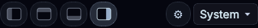</p>

言語は **最上部、レイアウト切替アイコン・⚙（UI 倍率）と同じ行の右端のプルダウン** で
**System / 日本語 / English** を選びます（0.9.1 でこの位置へ移動。「Language」の文字は
プルダウンのツールチップに出ます）。
System は Maya / OS の言語に従います。選択は保存され、**文言は次にウィンドウを開いたときに適用**されます
（ダイアログや警告は選んだ直後から新しい言語になります）。識別子・ノード名・パスは翻訳しません。

---

## 7. ツールボックス

### Effects

<p align="center">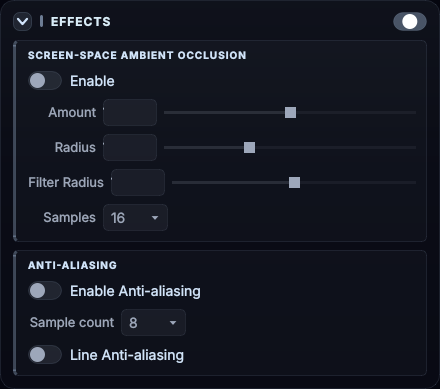</p>
見出し右のスイッチで **SSAO・アンチエイリアス・線 AA をまとめて ON/OFF** できます。
OFF にしても各項目の値は保持され、ON に戻すと復元されます。見出し左の開閉ボタンでカードを畳めます。

- **Screen-space Ambient Occlusion** … Enable / Amount / Radius / Filter Radius / Samples
- **Anti-aliasing** … Enable / Sample count / Line Anti-aliasing
- **調整プリセット** … Effects の値と ON/OFF をまとめて名前を付けて保存できます。プルダウンで選ぶと保存した値を適用します。
  **＋** = 今の値で新しいプリセットを作る、**✓** = 選択中のプリセットを今の値で更新、**↺** = 選択中のプリセットの保存値へ戻す（保存値は変えません）

> 注意: SSAO と AA は Maya の Viewport 2.0 の **共通設定** です。ここで変えると Maya の全ビューポートに反映されます
> （Renderer > Viewport 2.0 の設定と同じもの）。

### Shadow

<p align="center">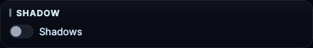</p>

ビューポートの `Lighting > Shadows` の ON/OFF。こちらは **このツールのビューだけ** に効きます。

### Show

<p align="center">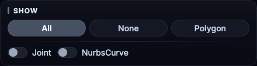</p>

**All / None / Polygon** のプリセット ＋ **Joint / NurbsCurve** スイッチ。
プリセットを押すと Joint / NurbsCurve もそのプリセットに従い（All=両方 ON、None/Polygon=両方 OFF）、
そこから個別に足したいものをスイッチで ON にします。

### Gate（レゾリューションゲート）

<p align="center">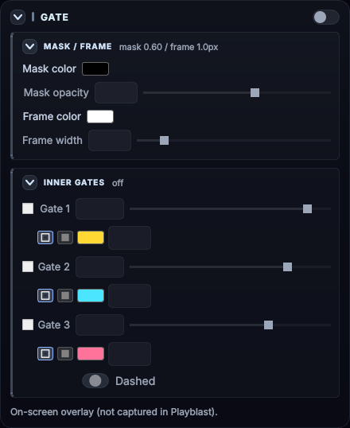
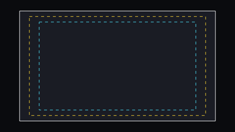</p>

見出し右のスイッチで ON にすると、**レンダー解像度の範囲（レゾリューションゲート）** を
各ビューの上にオーバーレイ表示します。ゲート矩形はカメラの viewing frustum
（ビューの縦横比・オーバースキャン・パン/ズーム込み）と rendering frustum
（レンダー解像度の縦横比）の比から求め、カメラ操作に追従します。

- **Mask / Frame** … ゲートの外側を覆うマスクの色と不透明度、ゲートの枠線の色と太さ
- **Inner gates** … ゲートに対する **% 指定の内側ゲートを 3 つまで**。それぞれ ON/OFF、%、色、
  **線**（1px、Dashed で破線）と **塗り**（そのゲートの外側＝レゾリューションゲート内を色で覆う）、
  塗りの不透明度を指定できます。セーフフレームやテロップ安全枠などに使います。

> ゲートと次章のガイドは **画面上のオーバーレイ** です。VP2 のレンダラ設定には触れず、
> **Playblast には写りません**（画面確認専用）。

### Guides（構図ガイド）

<p align="center">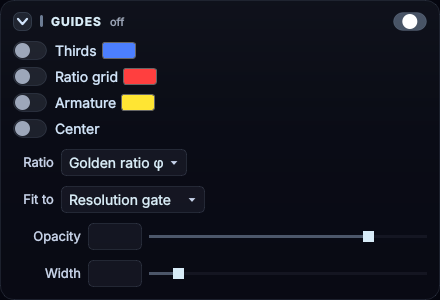</p>

見出し右のスイッチで構図ガイド全体を ON/OFF します（各系統のスイッチはそのまま保持されます）。
各ガイドの線は次のとおりです（下の比較図は gate_overlay.py の実描画コードによる出力）。

| 三分割 | 比率グリッド（黄金 φ） |
|---|---|
| 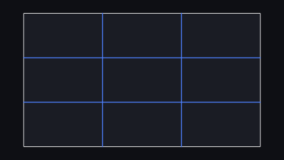 | 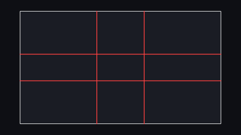 |

| 比率グリッド（白銀 √2） | アーマチュア（黄金 φ） |
|---|---|
| 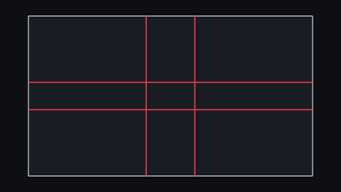 | 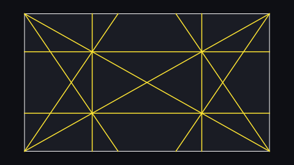 |

| アーマチュア（白銀 √2） | |
|---|---|
| 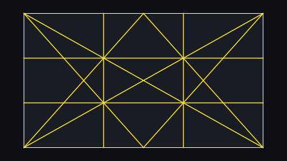 | |

| ガイド | 線の意味 |
|---|---|
| **三分割（Thirds）** | 1/3・2/3 の位置の縦横線（縦 2 本＋横 2 本） |
| **比率グリッド（Ratio Grid）** | 選んだ比率の分割位置の縦横線。**黄金比 φ では 0.382 / 0.618**、**白銀比 √2 では 0.414 / 0.586** |
| **アーマチュア（Armature）** | **対角線 2 本** ＋ **各隅から対角線への垂線（reciprocal）4 本** ＋ **交点（目）を通る縦横 4 本**。黄金比（または白銀比）の矩形で計算して、合わせ先の枠に引き伸ばします |
| **中心（Center）** | 中心の十字マーク |

- **Ratio** … 黄金比 φ（≈1.618）/ 白銀比 √2（≈1.414）。比率グリッドとアーマチュアの計算に使います。
- **Fit to** … ガイドを合わせる矩形。**レゾリューションゲート**（既定）/ **内側ゲート 1〜3**（Inner gates の % を使用。
  内側ゲートを表示していなくても計算には使えます）/ **ビュー全体**。
- **色**（三分割 / グリッド / アーマチュアで個別）、**Opacity**、**Width** を調整できます。

### Playblast

<p align="center">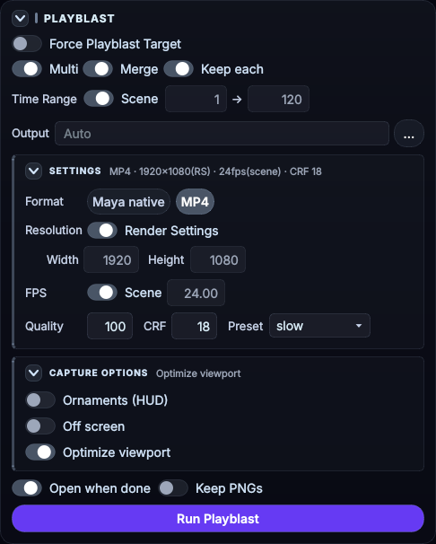</p>

上から **Force Playblast Target** / **Multi**（ON で右に 合成・個別保持）/ **Time Range** / **出力先** /
**SETTINGS**（畳める）/ **撮影オプション**（畳める）/ **完了後に開く・PNG を残す** / **［Playblast 実行］** の順です。
スイッチを切り替えても部品の位置や行の数は変わりません。めったに変えない書き出し設定は **SETTINGS** に
まとまっていて、畳んでいるときは見出しの右に「MP4 · 1920×1080 · 24fps(scene) · CRF 18」のように現在値が出ます。
詳細は次章。

---

## 8. Playblast

### Force Playblast Target（対象の固定）
Maya の Playblast は「今フォーカスがあるパネル」を対象にするため、別ウィンドウのビューは
クリックしていないと撮れません。このスイッチを ON にすると、
**Maya 標準メニュー（Windows > Playblast）からでも、Python 製の外部ツールからでも**、
対象がこのツールのビューに固定されます。表示設定の変更（Polygon のみにする等）も同じビューに向かうので、
自動化ツールが意図通りに動きます。

対象外・例外:

- **MEL から直接 Playblast を実行するツールは対象外**です
- **実行側が対象のパネルを明示しているツールは、その指定を尊重**します
- **設定の読み取り（query）には介入しません**
- **Playblast のオプションボックス（□）は Maya 標準のダイアログ**を開きます
- スイッチを OFF にする（またはウィンドウを閉じる）と**完全に元へ戻ります**

### 書き出し（Maya 標準 / MP4）
ツールボックスの **［Playblast 実行］** で撮ります（形式に関係なく同じボタンです）。

**直下（ショットごとに触るもの）**

| 項目 | 内容 |
|---|---|
| Time Range | **シーン範囲** ON = 撮影時点のシーンの再生範囲。OFF にすると同じ行の 開始 → 終了 を入力できます（ON の間はシーンの範囲が入った状態で押せません） |
| 出力先 | 空なら `<プロジェクト>/movies/<シーン名>_<カメラ名>` |
| 完了後に開く | 書き出した動画を開く（Maya 標準では Maya のビューア） |
| PNG を残す | 中間の PNG 連番を削除しない。**MP4 のときだけ表示** |

**SETTINGS（めったに変えないもの）**

| 項目 | 内容 |
|---|---|
| 出力形式 | **Maya 標準 / MP4** |
| 解像度 | **レンダー設定** ON = Maya 標準 Playblast の「Display size: From Render Settings」と同じ（レゾリューションゲートぴったり）。ON の間、幅・高さの欄はレンダー設定の値が入った状態で押せません。OFF で自分の指定値に戻ります |
| FPS | **シーン** ON = シーンの時間単位から決める。ON の間、右の欄はシーンの FPS が入った状態で押せません |
| 品質 / CRF / プリセット | 品質 = playblast の quality（1–100）。CRF = H.264 の品質（低いほど高画質・18–23 推奨）、プリセット = x264 のエンコード速度。CRF とプリセットは **MP4 のときだけ表示** |

**撮影オプション**

| 項目 | 内容 |
|---|---|
| 装飾 (HUD) | `showOrnaments`（HUD やカメラ名などを写す） |
| オフスクリーン | `offScreen`（他ウィンドウの重なりに影響されない） |
| ビューポート最適化 | 書き出し中だけ、画角をレンダー枠（解像度ゲート）に固定 / Polygon とイメージプレーンのみ表示 / Use All Lights にし、完了後に元へ戻す。SSAO・AA は Effects の設定のまま撮る |

すべての値は自動保存されます。

> Gate / Guides のオーバーレイは Playblast には写りません。

### 複数カメラ出力（Multi）

**Multi** を ON にすると、各ビューのカメラバーの **● PLAYBLAST** で対象を複数選べます（最大 4）。
**合成** ON で、表示中の位置・比率を保った 1 本（`_Multi.mp4`）に合成します。
**個別保持** ON なら各カメラの出力も残します。同じ名前の出力が既にあると、上書きしてよいかを確認します。
詳しい規則（出力名、カメラ名の重複、取消時の保全など）は
[MULTI_PLAYBLAST.md](MULTI_PLAYBLAST.md) を参照してください。

### MP4 出力に必要なもの（ffmpeg）
MP4 出力はパッケージ内 `bin/` に置いた `ffmpeg.exe` だけを使います（PATH 上の ffmpeg は参照しません）。
インストーラで導入した場合の実際の場所は次のとおりです:

```
<Maya の userAppDir>/modules/plsCamView/scripts/plsCamView/bin/ffmpeg.exe
例) C:/Users/<ユーザー名>/Documents/maya/modules/plsCamView/scripts/plsCamView/bin/ffmpeg.exe
```

（手動で scripts パスに置いた場合は、その `plsCamView/bin/ffmpeg.exe`。
MP4 実行時のエラーメッセージにも、置くべき実パスがそのまま表示されます。）

**更新しても消えません** — 新しい zip で上書きインストールするとき、配布物に ffmpeg が
入っていなければ、既に置いてある `bin/ffmpeg.exe` は自動で引き継がれます。

Windows 用の ffmpeg は https://www.gyan.dev/ffmpeg/builds/ の「essentials」ビルドで動きます
（zip 内の `bin/ffmpeg.exe` を取り出して置くだけ）。
ffmpeg は LGPL/GPL のソフトウェアで、本ツールは外部プロセスとして呼び出すだけです。

### Python から呼ぶ
```python
import plsCamView
plsCamView.playblast_mp4()                                       # ツールボックスの設定で書き出す
plsCamView.playblast_mp4(output_path="D:/out/s01.mp4", crf=20)   # 一部を上書き
```
戻り値は `(成功したか, メッセージ, 出力パス)` です。

---

## 9. 設定の保存とリセット

すべての状態は次のファイルに自動保存されます。

```
<Maya の userPrefDir>/plsCamView/settings.json
例) C:/Users/<ユーザー名>/Documents/maya/2026/prefs/plsCamView/settings.json
```

初期状態に戻したいときは Script Editor で:
```python
import plsCamView
plsCamView.reset_settings()
```

---

## 10. こんなときは

| 症状 | 対処 |
|---|---|
| ウィンドウが出ない / 何も起きない | Script Editor のエラーを確認。`plsCamView.restart()` で開き直す |
| ビューポートのメニューやアイコンバーが反応しない | `settings.json` の `useCopyPanel` を `false` にして開き直す |
| Playblast が別のビューで撮れてしまう | Playblast カードの **Force Playblast Target** を ON にする。カメラバーの **● PLAYBLAST** が目的のビューで紫に点灯しているか確認 |
| MP4 で「ffmpeg が見つかりません」 | `bin/ffmpeg.exe` を配置する（8 章） |
| SSAO / AA を変えたら Maya 全体が変わった | 仕様です（Viewport 2.0 の共通設定）。Effects の一括スイッチで戻せます |
| ゲートやガイドが表示されない | Gate / Guides の見出し右のスイッチが ON か、Guides は各系統（三分割など）のスイッチも ON か確認 |
| ゲートが Playblast に写ってほしい | 写りません（画面確認専用のオーバーレイです）。レンダー枠での書き出しは「ビューポート最適化」の画角固定を使います |
| UI の言語が変わらない | 文言は次にウィンドウを開いたときに適用されます。`plsCamView.restart()` でも反映できます |
| コードを更新したのに反映されない | `plsCamView.restart()`（Maya の再起動は不要） |

---

## 11. ライセンス

MIT License。ffmpeg は別ライセンス（LGPL/GPL）のソフトウェアで、本ツールは外部プロセスとして呼び出すだけです。
